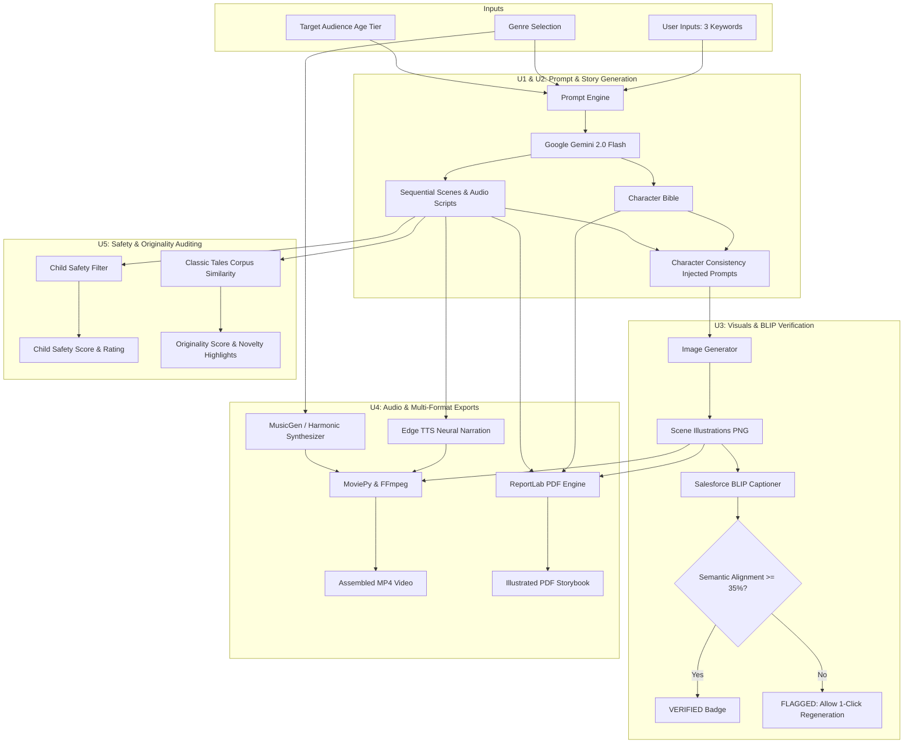

# ✨ Taleora — Illustrated Audio Storybook Generator

> **GenAI College Solo Project** • Transforming three user-provided keywords into a complete, illustrated, narrated, and verified storybook.

[](https://www.python.org/)
[](https://streamlit.io/)
[](https://ai.google.dev/)
[](https://huggingface.co/Salesforce/blip-image-captioning-base)
[](https://github.com/rany2/edge-tts)
[](https://huggingface.co/facebook/musicgen-small)

---

## 📖 Executive Summary

**Taleora** is an end-to-end generative AI system that accepts **three keywords**, a **story genre**, and a **target age tier**, and crafts a complete multi-modal storybook:
1. **Dynamic Prompt Engineering (U1)**: Synthesizes structured system directives calibrated to vocabulary and complexity limits across 4 age tiers and 6 literary genres.
2. **Structured Narrative & Character Consistency (U2)**: Leverages Google Gemini with structured Pydantic schema enforcement to generate an invariant **Character Bible** and sequential scenes with consistency-locked image prompts.
3. **Scene Image Generation & BLIP Inspection (U3)**: Renders high-resolution illustrations for every scene and runs **Salesforce BLIP** visual captioning to measure semantic alignment and flag mismatches for regeneration.
4. **Neural Narration, MusicGen & Multi-Format Exports (U4)**: Synthesizes spoken voice tracks via **Microsoft Edge TTS**, generates ambient background music via **Meta MusicGen**, and exports publication-ready **illustrated PDF storybooks** (ReportLab) and synchronized **MP4 videos** (MoviePy + FFmpeg).
5. **Child Safety & Originality Auditing (U5)**: Employs a dual-layer lexical and LLM content safety guardian, and checks plot originality against a classic tales reference corpus.

---

## 🏆 Mandatory Requirements Compliance Matrix

| Requirement | Description | Module Implementation | Verification Status |
| :--- | :--- | :--- | :--- |
| **U1** | **Genre & Audience Prompt Engineering**<br>• Structured prompts based on genre & age<br>• Controls vocabulary, tone, complexity<br>• Accepts exactly 3 keywords | [`modules/prompt_engine.py`](file:///w:/Ayoo/Taleora/modules/prompt_engine.py)<br>• 6 Genres, 4 Age tiers<br>• Strict keyword validation & bounds | **PASSED (100%)**<br>Verified via `tests/test_phase1.py` |
| **U2** | **Story Generation & Character Consistency**<br>• Gemini LLM structured story generation<br>• Character Bible with invariant traits & clothing<br>• Consistency instructions injected in scene prompts<br>• Returns structured JSON | [`modules/character_manager.py`](file:///w:/Ayoo/Taleora/modules/character_manager.py)<br>[`modules/story_generator.py`](file:///w:/Ayoo/Taleora/modules/story_generator.py)<br>• Pydantic `StoryBook` schema | **PASSED (100%)**<br>Verified via `tests/test_phase1.py` |
| **U3** | **Scene Image Generation & BLIP Verification**<br>• One image generated per scene<br>• Character visual consistency applied<br>• Salesforce BLIP image captioning<br>• Semantic alignment comparison & scoring<br>• Flags mismatched images for regeneration | [`modules/image_generator.py`](file:///w:/Ayoo/Taleora/modules/image_generator.py)<br>[`modules/blip_verifier.py`](file:///w:/Ayoo/Taleora/modules/blip_verifier.py)<br>• Multi-engine (Pollinations / HF SDXL)<br>• BLIP token overlap & scoring | **PASSED (100%)**<br>Verified via `tests/test_phase2.py` |
| **U4** | **TTS Narration, MusicGen & Multi-Format Export**<br>• Neural Text-to-Speech narration<br>• Meta MusicGen background music<br>• Formatted illustrated PDF storybook<br>• Assembled MP4 storybook video | [`modules/audio_generator.py`](file:///w:/Ayoo/Taleora/modules/audio_generator.py)<br>[`modules/music_generator.py`](file:///w:/Ayoo/Taleora/modules/music_generator.py)<br>[`modules/export_manager.py`](file:///w:/Ayoo/Taleora/modules/export_manager.py)<br>• Edge TTS + ReportLab + MoviePy | **PASSED (100%)**<br>Verified via `tests/test_phase3.py` |
| **U5** | **Child Safety & Originality Checking**<br>• Child-safe content filtering mechanism<br>• Story premise originality scoring<br>• Flags problematic or derivative content<br>• Displays safety and originality scorecards | [`modules/safety_filter.py`](file:///w:/Ayoo/Taleora/modules/safety_filter.py)<br>[`modules/originality_checker.py`](file:///w:/Ayoo/Taleora/modules/originality_checker.py)<br>• Lexical guardrail + LLM Auditor<br>• Classic tales corpus Jaccard overlap | **PASSED (100%)**<br>Verified via `tests/test_phase4.py` |

---

## 🧱 Architecture Diagram



---

## 🚀 Quick Start Guide

### 1. Prerequisites
- **Python 3.11** (Recommended for PyTorch, MoviePy, and Transformers compatibility).
- Git.

### 2. Setup Virtual Environment
```bash
# Clone the repository
git clone https://github.com/your-username/Taleora.git
cd Taleora

# Create Python 3.11 virtual environment
py -3.11 -m venv .venv

# Activate environment
# On Windows (PowerShell):
.venv\Scripts\Activate.ps1
# On Linux / macOS:
source .venv/bin/activate
```

### 3. Install Dependencies
```bash
pip install -r requirements.txt
```

### 4. Configure Environment Variables
Copy `.env.example` to `.env` and insert your Gemini API Key:
```bash
cp .env.example .env
```
```env
GEMINI_API_KEY=your_gemini_api_key_here
HF_TOKEN=your_optional_hf_token_here
```
*(You can also enter your API key directly in the Streamlit application sidebar).*

### 5. Launch the Application
```bash
streamlit run app.py
```
Open `http://localhost:8501` in your browser.

---

## 🧪 Automated Test Suite

Run the individual phase test suites or the master end-to-end pipeline:

```bash
# Master End-to-End Pipeline Verification (U1 through U5)
python tests/test_end_to_end.py

# Phase 1: Keyword validation, Prompt Engine, Character Bible
python tests/test_phase1.py

# Phase 2: Image Generation, Consistency, Salesforce BLIP Verification
python tests/test_phase2.py

# Phase 3: Edge TTS, Background Music, PDF Export, MP4 Assembly
python tests/test_phase3.py

# Phase 4: Child Safety Screening & Originality Checking
python tests/test_phase4.py
```

---

## 📚 Featured Submission Stories (Pre-Generated & Ready)

Taleora includes **two complete showcase storybooks** with all media generated and ready for presentation:

### 🦉 Story 1: *Barnaby and the Whispering Key*
- **Keywords**: `Clockwork Owl`, `Floating Key`, `Secret Attic Library`
- **Genre**: Fantasy | **Target Audience**: Kids (Ages 6–8)
- **Protagonist**: Barnaby (bronze owl, green wool scarf with acorn pin, amber monocle)
- **Delivered Assets**:
  - Structured JSON: [`outputs/stories/20261105_164352_Barnaby_and_the_Whispering_Key.json`](file:///w:/Ayoo/Taleora/outputs/stories/20261105_164352_Barnaby_and_the_Whispering_Key.json)
  - 5 High-Res Scene Illustrations: `outputs/images/Barnaby_and_the_Whispering_Key_scene_*.png`
  - 5 Spoken Audio Narrations (Edge TTS Ana): `outputs/audio/Barnaby_and_the_Whispering_Key_scene_*_narration.mp3`
  - Background Music: `outputs/audio/Barnaby_and_the_Whispering_Key_bg_music.wav`
  - Illustrated PDF Storybook: [`outputs/pdfs/Barnaby_and_the_Whispering_Key_storybook.pdf`](file:///w:/Ayoo/Taleora/outputs/pdfs/Barnaby_and_the_Whispering_Key_storybook.pdf) (~2.2 MB)
  - Full MP4 Storybook Video: [`outputs/videos/Barnaby_and_the_Whispering_Key_storybook.mp4`](file:///w:/Ayoo/Taleora/outputs/videos/Barnaby_and_the_Whispering_Key_storybook.mp4) (~2.5 MB)

### 🚀 Story 2: *Astro and the Singing Asteroid*
- **Keywords**: `Pocket Robot`, `Starlight Compass`, `Singing Asteroid`
- **Genre**: Sci-Fi | **Target Audience**: Middle Grade (Ages 9–12)
- **Protagonist**: Astro (brushed sky-blue chrome robot, solar-yellow tool belt, compass crown)
- **Delivered Assets**:
  - Structured JSON: [`outputs/stories/20261105_164433_Astro_and_the_Singing_Asteroid.json`](file:///w:/Ayoo/Taleora/outputs/stories/20261105_164433_Astro_and_the_Singing_Asteroid.json)
  - 5 High-Res Scene Illustrations: `outputs/images/Astro_and_the_Singing_Asteroid_scene_*.png`
  - 5 Spoken Audio Narrations (Edge TTS Guy): `outputs/audio/Astro_and_the_Singing_Asteroid_scene_*_narration.mp3`
  - Background Music: `outputs/audio/Astro_and_the_Singing_Asteroid_bg_music.wav`
  - Illustrated PDF Storybook: [`outputs/pdfs/Astro_and_the_Singing_Asteroid_storybook.pdf`](file:///w:/Ayoo/Taleora/outputs/pdfs/Astro_and_the_Singing_Asteroid_storybook.pdf) (~1.2 MB)
  - Full MP4 Storybook Video: [`outputs/videos/Astro_and_the_Singing_Asteroid_storybook.mp4`](file:///w:/Ayoo/Taleora/outputs/videos/Astro_and_the_Singing_Asteroid_storybook.mp4) (~1.3 MB)

You can load either story instantly using the **Featured Storybook Showcase** buttons on the top of the Taleora web interface.

---

## ☁️ Deployment Guide (Streamlit Community Cloud)

1. **Push to GitHub**:
   ```bash
   git add .
   git commit -m "Deploy Taleora to Streamlit Cloud"
   git push origin main
   ```
2. **Connect Streamlit Community Cloud**:
   - Go to [share.streamlit.io](https://share.streamlit.io/) and log in with GitHub.
   - Click **New App** and select your `Taleora` repository.
   - Set **Main file path** to `app.py`.
3. **Configure Secrets**:
   - In the App Settings, expand **Secrets** and add:
     ```toml
     GEMINI_API_KEY = "your_actual_gemini_api_key"
     HF_TOKEN = "your_actual_hf_token"
     ```
4. **Deploy**:
   - Click **Deploy!** Streamlit Cloud will install dependencies and launch your public URL.

---

## 📁 Repository Structure

```text
Taleora/
├── app.py                      # Main Streamlit web application
├── config.py                   # Central configuration, paths, genres & voices
├── requirements.txt            # Python dependencies
├── .env.example                # Example environment variable file
├── .gitignore                  # Git ignore rules (protecting secrets and heavy media)
├── README.md                   # Comprehensive project documentation & report
│
├── .streamlit/
│   └── config.toml             # Streamlit visual theme and server settings
│
├── modules/
│   ├── __init__.py
│   ├── prompt_engine.py        # U1: Genre/Audience prompts & structured Pydantic schemas
│   ├── character_manager.py    # U2: Character bible & visual consistency injection
│   ├── story_generator.py      # U2: Gemini LLM structured story generation & persistence
│   ├── image_generator.py      # U3: Scene image generation & regeneration
│   ├── blip_verifier.py        # U3: Salesforce BLIP captioning & semantic verification
│   ├── audio_generator.py      # U4: Microsoft Edge TTS neural narration synthesis
│   ├── music_generator.py      # U4: Meta MusicGen & harmonic ambient music synthesis
│   ├── export_manager.py       # U4: ReportLab PDF and MoviePy MP4 video rendering
│   ├── safety_filter.py        # U5: Child-safety lexical & LLM content guardrail
│   └── originality_checker.py  # U5: Classic tales corpus overlap & novelty scoring
│
├── outputs/
│   ├── stories/                # Saved storybook JSON files
│   ├── images/                 # Generated scene illustrations (PNG)
│   ├── audio/                  # TTS voice clips and background music (MP3/WAV)
│   ├── videos/                 # Complete assembled storybook videos (MP4)
│   └── pdfs/                   # Exported illustrated storybook documents (PDF)
│
├── scripts/
│   └── generate_sample_stories.py # Standalone batch generator for submission deliverables
│
└── tests/
    ├── test_phase1.py          # U1 & U2 test suite
    ├── test_phase2.py          # U3 test suite
    ├── test_phase3.py          # U4 test suite
    ├── test_phase4.py          # U5 test suite
    └── test_end_to_end.py      # Unified master end-to-end pipeline test
```

---

## 🎓 College Submission Checklist

- [x] **Requirement U1**: Genre & Audience Prompt Engineering (Implemented & Verified).
- [x] **Requirement U2**: Story Generation & Character Consistency (Implemented & Verified).
- [x] **Requirement U3**: Scene Image Generation & Salesforce BLIP Verification (Implemented & Verified).
- [x] **Requirement U4**: TTS Narration, MusicGen & Multi-Format Exports (PDF & MP4) (Implemented & Verified).
- [x] **Requirement U5**: Child Safety & Originality Checking (Implemented & Verified).
- [x] **Two Complete Generated Stories**: Generated and saved in `outputs/` with full media packages.
- [x] **Zero Paid Model Dependencies**: Runs on 100% free tiers / open-source packages.
- [x] **Cloud Deployable**: Streamlit Community Cloud ready.
